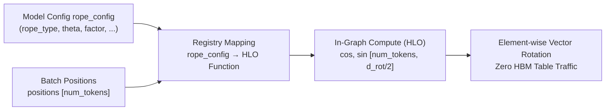
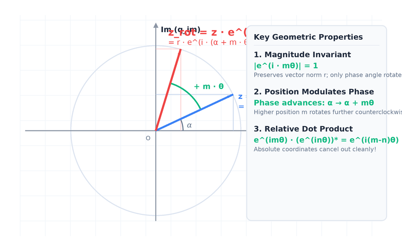

# RFC: Compute RoPE In-Graph by Default (`rope_config -> HLO Graph Function`)

## 1. Summary & Motivation

In Transformer attention mechanisms, Rotary Position Embedding (RoPE) is fundamentally an elementary mathematical function mapping a token position $p$ and model configuration `rope_config` to cosine and sine values.

Historically, LLM serving engines precompute a large lookup table of shape $[L_{\max}, d_{\text{rot}}]$ and store it in accelerator High Bandwidth Memory (HBM). For modern long-context models ($L_{\max} \ge 128\text{k}$ tokens), this pattern introduces significant operational and architectural pain points:
- **Wasted Memory**: Multi-gigabyte lookup tables reside permanently in HBM even when serving short requests.
- **Serving Fragility**: Serving systems must maintain complex table slicing, memory reallocation, padding, speculative decoding boundary protection, and model-specific table patching hacks.
- **TPU Execution Mismatch**: On TPUs, arithmetic and transcendental operations (evaluating polynomials, `exp`, `sin`, and `cos` in vector registers) are orders of magnitude faster and more memory-bandwidth efficient than pulling gigabytes of precomputed tables across the memory bus.

### Core Design Principles
1. **No Precomputed Global Tables in HBM, No Heuristic Content Fallbacks**: The serving engine does not store static tables in device memory, nor does it attempt to guess or reverse-engineer rotation parameters by inspecting table weights.
2. **Pure Deterministic Function (`rope_config -> HLO Graph Function`)**: Every RoPE variant supported in vLLM is uniquely determined by `rope_config`. We maintain a clean, extensible registry of mathematical functions that directly evaluate $\cos$ and $\sin$ inside the compiled XLA/HLO graph given `positions [num_tokens]`.
3. **Runner Simplicity**: The TPU model runner and attention kernel remain strictly decoupled from RoPE idiosyncrasies, executing simple element-wise operations on in-graph activations.



---

## 2. Mathematical Foundations: Euler's Formula & $2 \times (d/2)$ Matrix Representation

### 2.1 Partitioning a $d$-Dimensional Vector into a $2 \times (d/2)$ Matrix

For a single token at a single attention head, the query vector $\mathbf{q} \in \mathbb{R}^d$ and key vector $\mathbf{k} \in \mathbb{R}^d$ are 1D real vectors of even length $d$ (head dimension, typically $d = 128$).

To perform planar rotations, we divide the $d$ real elements of $\mathbf{q}$ into two groups of length $d/2$:
- **Real component row vector**: $\mathbf{q}_{\text{re}} \in \mathbb{R}^{1 \times (d/2)}$
- **Imaginary component row vector**: $\mathbf{q}_{\text{im}} \in \mathbb{R}^{1 \times (d/2)}$

#### Model-Specific Channel Splitting (`is_neox_style`)

How a 1D vector $\mathbf{q}$ of length $d$ is partitioned into $\mathbf{q}\sb{\text{re}}$ and $\mathbf{q}\sb{\text{im}}$ is determined by the model architecture (configured via `is_neox_style`). **Regardless of which partition convention is chosen, all subsequent mathematical rotation and dot-product formulas remain identical:**

##### 1. First-Half / Second-Half Partition (GPT-NeoX Style, `is_neox_style = True`)

The first $d/2$ elements form the real part, and the second $d/2$ elements form the imaginary part:

```math
\begin{aligned}
\mathbf{q}_{\text{re}} &= [q_0,\; q_1,\; \dots,\; q_{d/2 - 1}] \\
\mathbf{q}_{\text{im}} &= [q_{d/2},\; q_{d/2 + 1},\; \dots,\; q_{d - 1}]
\end{aligned}
\qquad \xrightarrow{d=4} \qquad
Q = \begin{bmatrix} \mathbf{q}_{\text{re}} \\ \mathbf{q}_{\text{im}} \end{bmatrix} = \begin{bmatrix} q_0 & q_1 \\ q_2 & q_3 \end{bmatrix}
```

*Adopted by*: Llama family, Qwen family, Gemma, Mistral, Phi.

##### 2. Even / Odd Interleaved Partition (GPT-J / Original RoPE Style, `is_neox_style = False`)

Even-indexed elements form the real part, and odd-indexed elements form the imaginary part:

```math
\begin{aligned}
\mathbf{q}_{\text{re}} &= [q_0,\; q_2,\; \dots,\; q_{d - 2}] \\
\mathbf{q}_{\text{im}} &= [q_1,\; q_3,\; \dots,\; q_{d - 1}]
\end{aligned}
\qquad \xrightarrow{d=4} \qquad
Q = \begin{bmatrix} \mathbf{q}_{\text{re}} \\ \mathbf{q}_{\text{im}} \end{bmatrix} = \begin{bmatrix} q_0 & q_2 \\ q_1 & q_3 \end{bmatrix}
```

*Adopted by*: GPT-J, DeepSeek MLA (specific kernels), ChatGLM.

Under either partition, $\mathbf{q}$ forms a **$2 \times (d/2)$ real matrix $Q$**, where each column $j \in \{0, 1, \dots, d/2 - 1\}$ represents a point on the complex plane $\mathbb{C}$:

```math
Q = \begin{bmatrix} \mathbf{q}_{\text{re}} \\ \mathbf{q}_{\text{im}} \end{bmatrix} \in \mathbb{R}^{2 \times (d/2)}
\quad \Longleftrightarrow \quad
z_j^{(q)} = q_{\text{re}, j} + \mathrm{i}\, q_{\text{im}, j} \in \mathbb{C}, \quad j = 0, 1, \dots, \frac{d}{2} - 1
```

> **Note**: For Partial RoPE architectures, only the first $d\sb{\text{rot}}$ elements out of $d\sb{\text{head}}$ undergo rotation, while the remaining unrotated elements pass through unchanged.

---

### 2.2 Euler's Formula Representation: Phase Rotation by $e^{\mathrm{i} m\theta_j}$



According to Euler's formula, $e^{\mathrm{i}\alpha} = \cos\alpha + \mathrm{i}\sin\alpha$. Rotating a complex number $z_j^{(q)} = r e^{\mathrm{i}\alpha}$ counterclockwise by an angle $m\theta_j$ (where $m$ is the token position and $\theta_j$ is the angular frequency of channel $j$) is achieved by multiplying by the unit complex exponential $e^{\mathrm{i} m\theta_j}$:

```math
\tilde{z}_j^{(q)} = z_j^{(q)} \cdot e^{\mathrm{i} m\theta_j} = (q_{\text{re}, j} + \mathrm{i}\, q_{\text{im}, j})\bigl(\cos(m\theta_j) + \mathrm{i}\sin(m\theta_j)\bigr)
```

Expanding with $\mathrm{i}^2 = -1$ yields the rotated real and imaginary components:

```math
\begin{aligned}
\tilde{z}_j^{(q)} &= \bigl(q_{\text{re}, j}\cos(m\theta_j) - q_{\text{im}, j}\sin(m\theta_j)\bigr) + \mathrm{i}\,\bigl(q_{\text{im}, j}\cos(m\theta_j) + q_{\text{re}, j}\sin(m\theta_j)\bigr) \\[4pt]
\tilde{q}_{\text{re}, j} &= q_{\text{re}, j}\cos(m\theta_j) - q_{\text{im}, j}\sin(m\theta_j) \\
\tilde{q}_{\text{im}, j} &= q_{\text{im}, j}\cos(m\theta_j) + q_{\text{re}, j}\sin(m\theta_j)
\end{aligned}
```

---

### 2.3 One-Line Proof of Relative Position Dependency

The inner product of two 2D real vectors equals the real part of the product between one complex number and the complex conjugate of the other: $\langle \mathbf{u}, \mathbf{v} \rangle = \mathrm{Re}(u \cdot \overline{v})$.

For query at position $m$ ($z_j^{(q)} e^{\mathrm{i} m\theta_j}$) and key at position $n$ ($z_j^{(k)} e^{\mathrm{i} n\theta_j}$), the complex conjugate of the key is $\overline{z_j^{(k)}} e^{-\mathrm{i} n\theta_j}$. The dot product simplifies in a single step via exponential laws:

```math
\langle \tilde{\mathbf{q}}_m, \tilde{\mathbf{k}}_n \rangle
= \sum_{j=0}^{d/2 - 1} \mathrm{Re}\!\left( \bigl(z_j^{(q)} e^{\mathrm{i} m\theta_j}\bigr) \cdot \overline{\bigl(z_j^{(k)} e^{\mathrm{i} n\theta_j}\bigr)} \right)
= \sum_{j=0}^{d/2 - 1} \mathrm{Re}\!\left( z_j^{(q)} \overline{z_j^{(k)}} \, e^{\mathrm{i}(m - n)\theta_j} \right)
```

The absolute positions $m$ and $n$ cancel out, proving that attention logits depend strictly on the **relative distance $m - n$**.

---

### 2.4 Hardware Implementation: Element-Wise Multiply-Add (Hadamard Product)

On hardware accelerators (TPU / GPU), we arrange the cosine and sine values for position $m$ into row vectors of length $d/2$:

```math
\mathbf{c} = \bigl[\cos(m\theta_0),\; \dots,\; \cos(m\theta_{d/2 - 1})\bigr], \quad
\mathbf{s} = \bigl[\sin(m\theta_0),\; \dots,\; \sin(m\theta_{d/2 - 1})\bigr]
```

Applying RoPE to the matrix $Q$ is expressed purely via element-wise operations ($\odot$):

```math
\tilde{Q} = \begin{bmatrix} \tilde{\mathbf{q}}_{\text{re}} \\ \tilde{\mathbf{q}}_{\text{im}} \end{bmatrix}
= \begin{bmatrix} \mathbf{q}_{\text{re}} \\ \mathbf{q}_{\text{im}} \end{bmatrix} \odot \begin{bmatrix} \mathbf{c} \\ \mathbf{c} \end{bmatrix} +
\begin{bmatrix} -\mathbf{q}_{\text{im}} \\ \mathbf{q}_{\text{re}} \end{bmatrix} \odot \begin{bmatrix} \mathbf{s} \\ \mathbf{s} \end{bmatrix}
```

No dense matrix multiplication is performed; execution consists entirely of fused vector arithmetic.

---

## 3. Mathematical Taxonomy of RoPE Variants in vLLM

Standard RoPE defines base frequencies as a geometric progression across the $d_{\text{rot}}/2$ channels:

```math
\theta_i = b^{-\frac{2i}{d_{\text{rot}}}} = \frac{1}{b^{2i / d_{\text{rot}}}}, \quad i = 0, 1, \dots, \frac{d_{\text{rot}}}{2} - 1
```

where $b$ is `rope_theta` (typically $10000$ to $500000$).

### Physical Meaning of Index $i$: Multi-Scale Clock Mechanism

The channel index $i \in \{0, 1, \dots, d_{\text{rot}}/2 - 1\}$ indexes the frequency spectrum:
- **$i = 0$ (Fast Channel / "Second Hand")**: $\theta_0 = 1$. The phase rotates rapidly from token to token, producing large phase differences between adjacent tokens to resolve **local word order and syntactic structures**.
- **$i \to d_{\text{rot}}/2 - 1$ (Slow Channel / "Hour Hand")**: $\theta_i \approx 1/b \ll 1$. The phase rotates minimally even across thousands of tokens, preventing cycle aliasing to measure **global semantic distance across long contexts**.

All vLLM RoPE implementations modify one of four fundamental components:
1. **Frequency Formula $\theta_i$** (Frequency scaling variants)
2. **Amplitude Temperature $s$** (Magnitude scaling variants)
3. **Position-Dependent Frequencies** (Dynamic piecewise variants)
4. **Multi-Dimensional Coordinates** (Vision / Multimodal / Chunked variants)

---

### 3.1 Category 1: Frequency-Only Variants

These variants compute a static scaled frequency vector $\boldsymbol{\theta}^* \in \mathbb{R}^{d_{\text{rot}}/2}$ from `rope_config`:

#### 1. Default RoPE (`rope_type = "default"`)

```math
\theta_i^* = b^{-\frac{2i}{d_{\text{rot}}}}
```

#### 2. Linear Position Scaling (`rope_type = "linear"`)

Given context extension factor $c = \text{factor}$:

```math
\theta_i^* = \frac{b^{-2i / d_{\text{rot}}}}{c} = \frac{\theta_i}{c}
```

#### 3. NTK-Aware Scaling (`rope_type = "ntk"`)

Scales low frequencies (long range) while preserving high frequencies (local precision).

##### Fixed NTK

```math
\theta_i^* = \theta_i \cdot c^{-\frac{2(i + 1)}{d_{\text{rot}}}}
```

For $i=0$, the scale factor is $c^{-2/d_{\text{rot}}} \approx 1$ (unscaled high frequency). For $i=d_{\text{rot}}/2-1$, the scale factor is $c^{-1} = 1/c$ (fully interpolated low frequency).

##### Mixed NTK (with parameter $\beta = \text{mixed\_b}$)

```math
\theta_i^* = \frac{\theta_i}{\exp\!\left( \frac{\ln c}{(d_{\text{rot}}/2)^\beta} \cdot (i + 1)^\beta \right)}
```

#### 4. Dynamic NTK (`rope_type = "dynamic"`)

Adjusts the base dynamically based on sequence length:

```math
b' = b \cdot \left( \frac{c \cdot L_{\max}}{L_{\text{train}}} - (c - 1) \right)^{\frac{d_{\text{rot}}}{d_{\text{rot}} - 2}}, \quad \theta_i^* = (b')^{-\frac{2i}{d_{\text{rot}}}}
```

#### 5. Llama-3 Piecewise Smoothing (`rope_type = "llama3"`)

Given low-frequency factor $f_{\text{low}}$ and high-frequency factor $f_{\text{high}}$:

```math
\theta_i^* = \begin{cases}
\theta_i, & \lambda_i < \frac{L_{\text{orig}}}{f_{\text{high}}} \text{ (high-frequency: no scaling)} \\[6pt]
\dfrac{\theta_i}{c}, & \lambda_i > \frac{L_{\text{orig}}}{f_{\text{low}}} \text{ (low-frequency: linear scaling)} \\[8pt]
(1 - \gamma_i)\dfrac{\theta_i}{c} + \gamma_i \theta_i, & \text{transitional zone, where } \gamma_i = \dfrac{L_{\text{orig}}/\lambda_i - f_{\text{low}}}{f_{\text{high}} - f_{\text{low}}}
\end{cases}
```

#### 6. Gemma-4 Proportional Scaling (`rope_type = "proportional"`)

Uses full $d_{\text{head}}$ in the exponent for the active $d_{\text{rot}}$ dimensions and sets remaining frequencies to zero:

```math
\theta_i^* = \begin{cases}
b^{-\frac{2i}{d_{\text{head}}}}, & 0 \le i < \dfrac{d_{\text{rot}}}{2} \\[6pt]
0, & \dfrac{d_{\text{rot}}}{2} \le i < \dfrac{d_{\text{head}}}{2}
\end{cases}
```

---

### 3.2 Category 2: Magnitude Scaling Variants

These variants scale the rotated vector by a temperature or entropy-compensating factor $s$:

```math
\tilde{Q} = s \cdot \left( Q \odot C + Q_{\text{swap}} \odot S \right)
```

#### 1. YaRN (`rope_type = "yarn"`)

Blends frequency interpolation via smooth ramp $\gamma_i$ and applies temperature scaling:

```math
s = \sqrt{\frac{1}{t}}, \quad t = 0.1 \ln(c) + 1
```

#### 2. DeepSeek YaRN (`rope_type = "deepseek_yarn"`)

Extends YaRN with decoupled scalar temperature compensation:

```math
s = m_{\text{scale}} \cdot m_{\text{scale\_all\_dim}} = \left(0.1 \ln(c) + 1\right) \cdot \text{scale\_factor}
```

---

### 3.3 Category 3: Dynamic Piecewise & Causal Phase Variants

#### 1. Phi-3 LongRoPE (`rope_type = "longrope"`)

Applies non-uniform per-channel scale factors from pre-trained calibration:

```math
\theta_i^*(p) = \begin{cases}
\dfrac{\theta_i}{\text{short\_factors}_i}, & p \le L_{\text{orig}} \\[6pt]
\dfrac{\theta_i}{\text{long\_factors}_i}, & p > L_{\text{orig}}
\end{cases}
```

#### 2. DeepSeek-V4 Dual-Chunk RoPE (`rope_type = "dual_chunk"`)

Divides long context into chunks of size $C$. Token position $p = u \cdot C + v$ (chunk index $u = \lfloor p/C \rfloor$, local offset $v = p \pmod C$):
- First $d_1$ dimensions encode intra-chunk relative position $v$;
- Next $d_2$ dimensions encode inter-chunk coarse position $u$.

#### 3. FoPE (Forward-only Phase RoPE, `rope_type = "fope"`)

Replaces periodic rotations with monotonic forward-only relative phase clamping:

```math
\Delta\theta_{\text{eff}}(m, n) = \max(0, m - n) \cdot \theta_i^*
```

---

### 3.4 Category 4: Multi-Dimensional Coordinate RoPE (M-RoPE)

For multimodal and spatial-temporal models (Qwen2-VL, M-Llama4), position is a 3D tuple $(t, h, w)$ rather than a 1D scalar $p$.

The $d_{\text{rot}}/2$ frequency channels are partitioned into three disjoint sections:

```math
\frac{d_{\text{rot}}}{2} = D_t + D_h + D_w
```

For token with coordinate $(t, h, w)$:

```math
\theta_i^{\text{coord}} = \begin{cases}
t \cdot \theta_i^*, & 0 \le i < D_t \text{ (temporal/frame axis)} \\
h \cdot \theta_i^*, & D_t \le i < D_t + D_h \text{ (height/row axis)} \\
w \cdot \theta_i^*, & D_t + D_h \le i < \dfrac{d_{\text{rot}}}{2} \text{ (width/column axis)}
\end{cases}
```

---

## 4. `vllm-torchtpu` In-Graph Architecture

### 4.1 Registry Architecture: `rope_config -> HLO Graph Function`

```python
# Conceptual Python registry in vllm_torchtpu/layers/rotary_embedding/hlo_rope.py

ROPE_HLO_REGISTRY = {
    "default": compute_default_rope_hlo,
    "linear": compute_linear_rope_hlo,
    "ntk": compute_ntk_rope_hlo,
    "dynamic": compute_dynamic_ntk_rope_hlo,
    "llama3": compute_llama3_rope_hlo,
    "proportional": compute_gemma_proportional_rope_hlo,
    "yarn": compute_yarn_rope_hlo,
    "deepseek_yarn": compute_deepseek_yarn_rope_hlo,
    "mrope": compute_mrope_hlo,
}


def get_rope_hlo_evaluator(rope_config: dict, head_dim: int, dtype: torch.dtype):
  rope_type = rope_config.get("rope_type", "default")
  if rope_type not in ROPE_HLO_REGISTRY:
    raise NotImplementedError(f"Unsupported in-graph RoPE type: {rope_type}")
  return ROPE_HLO_REGISTRY[rope_type](rope_config, head_dim, dtype)
```

Each evaluator function:
1. Receives `positions: torch.Tensor [num_tokens]` (or `[3, num_tokens]` for M-RoPE).
2. Computes outer product $\mathbf{P} \otimes \boldsymbol{\theta}^*$ via XLA broadcast and evaluates `torch.cos` and `torch.sin`.
3. Returns `(cos, sin)` tensors shaped `[num_tokens, d_rot / 2]`.

### 4.2 Comparison: Precomputed Table vs. In-Graph HLO

| Dimension | Precomputed Lookup Table (Current Baseline) | In-Graph Dynamic HLO (This RFC) |
| :--- | :--- | :--- |
| **HBM Footprint** | Hundreds of MBs to GBs ($L_{\max} \times d_{\text{rot}} \times 2$) | **0 MB** (scalars in constant pool) |
| **Memory Bandwidth** | Memory bus bottleneck reading large tables | **Registers only** (fused transcendental arithmetic) |
| **Long Context Scaling** | Fragile (OOM or reallocation at $128\text{k}+$ tokens) | **Zero cost** (pure function of position index) |
| **Speculative Decoding** | Bounds checks needed for draft token positions | **Trivial** (arbitrary non-monotonic indices supported) |
| **Serving Robustness** | Patching hacks across model loaders | **Deterministic, self-contained, model-agnostic** |

---

## 5. Verification Plan

1. **Numerical Parity**: Validate maximum absolute difference $|\cos_{\text{hlo}}(p) - \cos_{\text{table}}(p)| < 10^{-5}$ across float32 and bfloat16 for all supported variants over position range $p \in [0, 131072]$.
2. **End-to-End Correctness**: Verify perplexity and greedy generation matching across Llama-3.1-8B, Qwen2.5-7B, DeepSeek-V3/V4, and Qwen2-VL-7B.
3. **Compilation Stability**: Verify StableHLO graph caching with static shapes under dynamic padding regimes.
